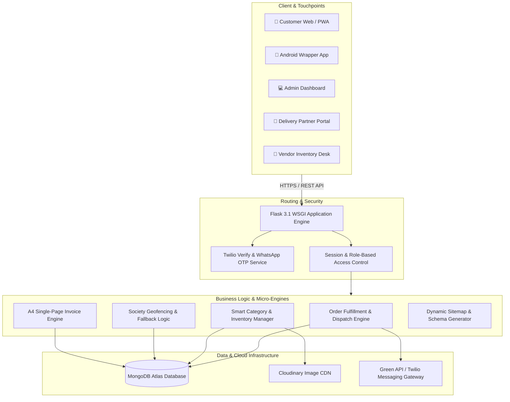

<div align="center">

  

  # 🛒 JIPPY STORE
  ### ⚡ *Next-Gen Hyperlocal Quick-Commerce & 10-Minute Grocery Delivery Engine*

  <p align="center">
    <b>A high-performance, real-time hyperlocal commerce ecosystem connecting customers, residential societies, local dark-stores, and delivery executives in under 15 minutes.</b>
  </p>

  <p align="center">
    <a href="#-key-features"></a>
    <a href="https://www.python.org/"></a>
    <a href="https://flask.palletsprojects.com/"></a>
    <a href="https://www.mongodb.com/cloud/atlas"></a>
  </p>

  <p align="center">
    
    
    
    
    
  </p>

  <br />

  <p align="center">
    <a href="#-quick-tour--portals"><b>Explore Portals »</b></a> •
    <a href="#-system-architecture"><b>Architecture »</b></a> •
    <a href="#-installation--setup"><b>Getting Started »</b></a> •
    <a href="#-seo--growth-stack"><b>SEO & Performance »</b></a>
  </p>

</div>

---

## 💎 Overview & Highlights

**Jippy Store** is an ultra-fast grocery delivery platform architected specifically for high-density residential societies and gated communities. Built from the ground up to solve the friction of hyper-local commerce, Jippy provides:

- ⚡ **10 to 15-Minute Doorstep Delivery**: Society-centric routing and dark-store fulfillment.
- 📱 **Omnichannel Experience**: Responsive web app, PWA installation, and Android WebView wrapper support.
- 🧾 **Precision Invoicing**: Instant A4-scaled thermal/PDF billing engine with client & server-side rendering.
- 🛡️ **Zero-Friction Authentication**: High-conversion WhatsApp & SMS OTP login flows.
- 🔍 **Google Rank #1 Ready**: Fully configured Local SEO, dynamic `sitemap.xml`, `robots.txt`, and Schema.org rich snippets.

---

## 🏛️ System Architecture



---

## 🚀 Portals & Core Modules

<table>
  <tr>
    <td width="50%">
      <h3 align="left">🛍️ Customer Storefront</h3>
      <ul>
        <li><b>Society Geofencing:</b> Tailored product availability and delivery time slots based on customer society.</li>
        <li><b>Real-Time Search & Filters:</b> Instant catalog lookup with unit pricing and discount indicators.</li>
        <li><b>Smart Cart:</b> Automatic subtotaling, dynamic delivery fees, and platform charge calculations.</li>
        <li><b>Order Tracking:</b> Live order status lifecycle (Pending → Packed → Out for Delivery → Delivered).</li>
      </ul>
    </td>
    <td width="50%">
      <h3 align="left">🛡️ Admin Command Center</h3>
      <ul>
        <li><b>Real-Time Analytics:</b> Live GMV metrics, order volumes, revenue breakdowns, and user activity.</li>
        <li><b>Order Dispatch Workflow:</b> Reassign orders, cancel, or flag delivery priority.</li>
        <li><b>Product & Inventory CRUD:</b> Add/edit items, manage variants, and upload high-res images to Cloudinary.</li>
        <li><b>Society & Partner Config:</b> Serviceable boundary management and commission settings.</li>
      </ul>
    </td>
  </tr>
  <tr>
    <td width="50%">
      <h3 align="left">🏪 Vendor Inventory Desk</h3>
      <ul>
        <li><b>Live Stock Toggles:</b> One-click product in-stock / out-of-stock switcher.</li>
        <li><b>Store Online/Offline Hanging Board:</b> Zomato-style smooth hanging board toggle with real-time customer alert.</li>
        <li><b>Order Queue:</b> Live sound notifications for incoming grocery orders.</li>
      </ul>
    </td>
    <td width="50%">
      <h3 align="left">🛵 Delivery Partner Portal</h3>
      <ul>
        <li><b>Society Route Optimization:</b> Clear tower, flat, and society navigation details.</li>
        <li><b>One-Touch Customer Call:</b> Direct dialer link for swift doorstep handoffs.</li>
        <li><b>Proof of Delivery:</b> Secure QR verification and verification code handoff.</li>
      </ul>
    </td>
  </tr>
</table>

---

## ⚡ SEO & Discovery Stack (Google Rank #1 Ready)

Jippy Store includes a production-grade Search Engine Optimization architecture engineered to achieve **#1 rankings on Google Search & Local Maps**:

```
├── robots.txt               # Directs Googlebot/Bingbot; secures private admin & vendor routes
├── sitemap.xml              # Dynamic XML sitemap auto-syncing all active categories & products
├── Schema.org (JSON-LD)     # Rich snippets: 'GroceryStore', 'LocalBusiness', 'WebSite'
├── Sitelinks SearchBox      # Enables direct in-Google catalog search
├── Local SEO (Geo Tags)     # Latitude/longitude & city targeting for Local 3-Pack
└── OpenGraph & Twitter Cards # Crisp rich media preview cards on WhatsApp, Twitter, and Facebook
```

---

## 🛠️ Technology Stack

| Domain | Technology | Purpose |
| :--- | :--- | :--- |
| **Backend** | [Python 3.9+](https://python.org/) & [Flask 3.1](https://flask.palletsprojects.com/) | REST API routing, session management, and server-side rendering |
| **Database** | [MongoDB Atlas](https://www.mongodb.com/) (PyMongo) | Flexible document store for orders, products, users, and societies |
| **Asset Storage** | [Cloudinary](https://cloudinary.com/) | Cloud-hosted, CDN-optimized product imagery |
| **Authentication** | WhatsApp OTP (Green API) & Twilio Verify | Instant phone verification and passwordless authentication |
| **Invoicing Engine** | jsPDF, html2canvas, html2pdf.js | Single-page A4 precision thermal and GST billing invoices |
| **Styling & UI** | TailwindCSS + Vanilla CSS3 & Plus Jakarta Sans | Fluid micro-interactions, responsive grids, and modern 3D depth |
| **Icons & Media** | FontAwesome 6 Pro, Crisp Favicons & PWA Manifest | Complete cross-platform desktop & mobile icon support |

---

## 📂 Project Architecture

```plaintext
Jippy Store/
├── app.py                                            # Master Flask application & API route handlers
├── requirements.txt                                  # Production Python dependencies
├── static/                                           # Static assets
│   ├── logo.png                                      # High-resolution master 512x512 brand logo
│   ├── favicon.ico                                   # Multi-resolution browser tab icon
│   ├── robots.txt                                    # Search engine crawler governance file
│   ├── manifest.json                                 # Progressive Web App (PWA) manifest
│   ├── images/                                       # Curated category banners & placeholders
│   └── sounds/                                       # Order alert and sound chimes
├── templates/                                        # Jinja2 template architecture
│   ├── base.html                                     # Master layout with SEO & Schema.org JSON-LD
│   ├── products.html                                 # Dynamic catalog view with category SEO
│   ├── cart.html                                     # Multi-item cart & checkout calculations
│   ├── invoice.html                                  # Standalone A4 single-sheet PDF invoice
│   ├── admin_dashboard.html                          # Operations command center
│   ├── portal_delivery.html                          # Rider delivery dispatch panel
│   └── portal_vendor.html                            # Dark-store inventory management
└── api/
    └── index.py                                      # Vercel / Serverless gateway entrypoint
```

---

## 💻 Installation & Setup

### 1. Clone the Repository
```bash
git clone https://github.com/your-username/jippy-store.git
cd "Jippy Store"
```

### 2. Configure Python Virtual Environment
```bash
# Windows
python -m venv .venv
.\.venv\Scripts\activate

# macOS / Linux
python3 -m venv .venv
source .venv/bin/activate
```

### 3. Install Requirements
```bash
pip install -r requirements.txt
```

### 4. Setup Environment Variables
Create a `.env` file in the root directory:
```env
# Flask
PORT=3001
SECRET_KEY=your_secure_random_key_here
BASE_URL=http://localhost:3001

# MongoDB Atlas
MONGO_URI=mongodb+srv://<username>:<password>@cluster.mongodb.net/jippy_store?retryWrites=true&w=majority

# Cloudinary Media
CLOUDINARY_CLOUD_NAME=your_cloud_name
CLOUDINARY_API_KEY=your_api_key
CLOUDINARY_API_SECRET=your_api_secret

# OTP & Messaging (WhatsApp / Twilio)
TWILIO_ACCOUNT_SID=your_twilio_sid
TWILIO_AUTH_TOKEN=your_twilio_auth_token
TWILIO_VERIFY_SERVICE_SID=your_verify_service_sid

# Fees & Settings
PLATFORM_FEE=2
MIN_FREE_DELIVERY_THRESHOLD=199
```

### 5. Launch the Server
```bash
python app.py
```
Visit `http://localhost:3001` in your browser.

---

## 🌐 Endpoints & Access Directory

| Portal | URL Route | Description |
| :--- | :--- | :--- |
| **Customer Storefront** | `/` or `/category/all` | Public grocery store and order placement |
| **Sitemap Index** | `/sitemap.xml` | Live Googlebot crawler sitemap |
| **Robots Directives** | `/robots.txt` | Crawler permissions and sitemap reference |
| **Admin Control Center** | `/admin/login` | Platform analytics and operations desk |
| **Delivery Executive Portal** | `/portal/login` | Delivery partner order routing and verification |
| **Vendor Inventory Desk** | `/portal/vendor` | Dark store stock and operational toggles |

---

<div align="center">
  <sub>Built with ❤️ for ultra-fast community commerce • © 2026 Jippy Store Hyperlocal Retail</sub>
</div>
